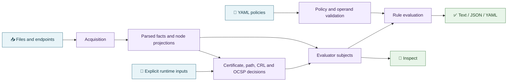

# 🏗️ PCL Architecture

[Documentation](docs/POLICY_WRITING_GUIDE.md)

PCL separates acquisition, parsing facts, domain decisions, policy evaluation,
and output. Network access belongs to acquisition; evaluation consumes prepared
evidence.

## 🔄 Data Flow

---

## 🧩 Ownership

| Package | Owns | Does not own |
|---|---|---|
| `internal/linter` | Configuration, acquisition, command orchestration, policy suites | Rule or cryptographic semantics |
| `internal/x509asn1`, `internal/x509ext` | Shared strict DER facts, optional-field presence, raw encodings | Trust decisions or rule verdicts |
| `internal/x509node`, `internal/certnode`, `internal/crlnode`, `internal/ocspnode` | Shared and object-specific node projections | Network acquisition |
| `internal/cert` | Certificate loading, profile semantics, names, purpose and constraints | Generic policy execution |
| `internal/path` | Bounded construction and explicit-anchor validation, policy processing | Network discovery |
| `internal/crl`, `internal/ocsp` | Evidence acquisition helpers and authenticated status assessment | Policy selection |
| `internal/evaluator` | Subject preparation, shared assessments, projected path findings | YAML syntax or rendering |
| `internal/policy`, `internal/rule` | Policy shape, includes, input filtering and rule evaluation | ASN.1 parsing or trust configuration |
| `internal/operator` | Registry, operand contracts, generic checks and domain adapters | Duplicate domain algorithms |
| `internal/node`, `internal/finding` | Shared tree and structured finding types | Policy or acquisition decisions |
| `internal/output` | Formatting and verbosity | Verdict calculation |

## 🔍 Parsing Boundary

Raw DER is authoritative for encoding-sensitive checks. Strict decoders retain
malformed/presence facts; node builders expose them for policies. A successfully
decoded extension is not automatically processable as a critical extension.
The location-specific registry only authorizes implemented semantics.
`x509ext` decides certificate critical-extension processability for path
validation; certificate node markers come from the same decoders, so
`noUnknownCriticalExtensions` reaches the same verdict on the tree. `path` and
`operator` never import node builders.

Keep reusable decoding in the shared parsing layer, representation in node
builders, and cross-certificate decisions in their domain. See the
[node contracts](docs/NODE_MODEL.md#strict-profile-extension-schemas).

## 📝 Policy Boundary

`Parse`, `ParseFile`, and `ParseDir` validate structure. Execution uses their
`WithRegistry` variants to validate operators and main, conditional, and nested
operands before processing inputs. `Registry.Evaluate` enforces contracts for
programmatically constructed invocations too.

Each built-in operand contract supplies validation and a schema fragment.
`pcl schema` assembles the editor schema from the registry; tests compare it
with the committed schema and exercise parser/schema agreement.

Metadata describes a pack. Includes merge rules only; the parent retains its
metadata and execution filters. Trust anchors, purpose, evidence and validation
time remain caller inputs. Generic policy evaluation does not depend on the
path engine.

## 🔐 Path Boundary

Construction selects one deterministic path from supplied/acquired candidates.
Validation separately checks it against explicit anchors and produces structured
findings. The evaluator projects those findings onto the target certificate;
a policy rule decides whether to require a successful aggregate result.

CRL and OCSP assessments are shared by path validation and profile operators.
CRL signer paths must reach the same explicit trust set when anchors are supplied.
See [coverage limits](policies/RFC5280-COVERAGE.md#limits) for supported forms.

## 🔧 Shared Commands

Lint, inspect, and policy tests use the same acquisition and profile-subject
pipeline. Lint evaluates rules; inspect prints trees; policy tests compare
evaluation results with expectations. Explicit path validation is prepared
for lint/test execution, while inspect exposes profile projections.
